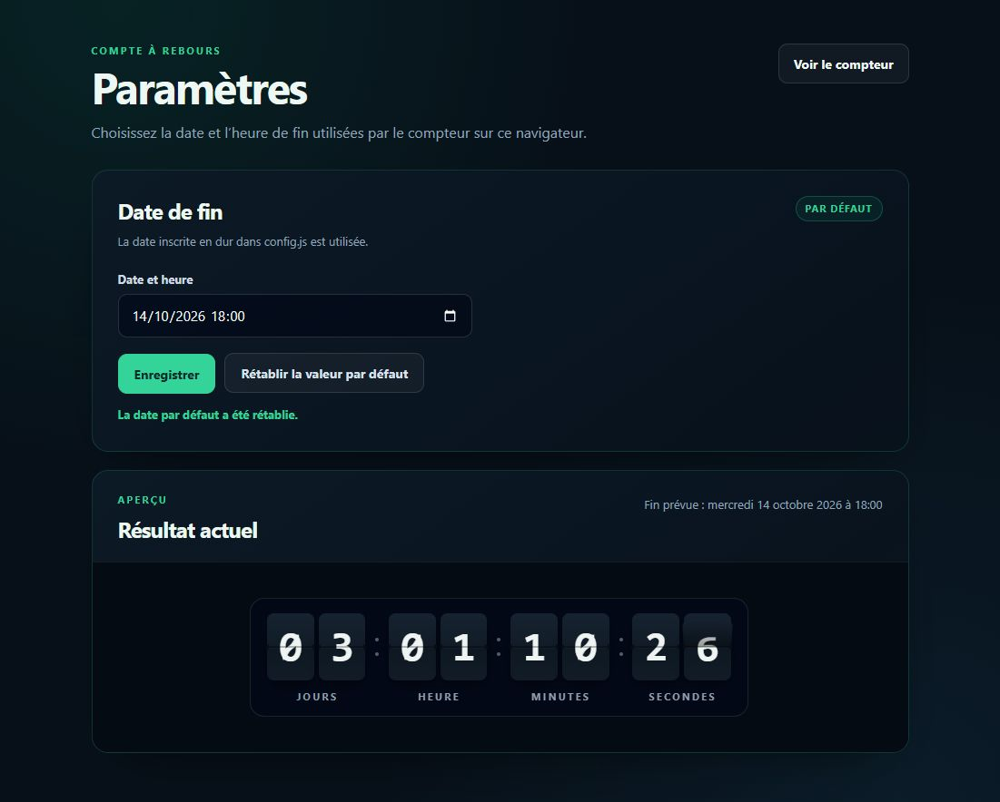

# Compte à rebours

Compteur à volets animé, personnalisable depuis une page de paramètres, en HTML, CSS et JavaScript. Interface française et thème sombre, sans dépendance externe ni étape de compilation.

## Aperçu de la page Paramètres



La capture fournie avec le projet montre la page Paramètres et le compteur intégré. La date et les valeurs affichées sont celles de cet aperçu ; elles ne représentent pas un compte à rebours en temps réel.

## Installation

Télécharger une version depuis [les releases](https://github.com/oOBenjaminOo/compte-a-rebours/releases) ou cloner ce dépôt :

```sh
git clone https://github.com/oOBenjaminOo/compte-a-rebours.git
cd compte-a-rebours
```

Ensuite, servir le dossier avec Apache, Nginx ou un serveur statique. Pour un essai local avec Python 3 :

```sh
python3 -m http.server 8080 --bind 127.0.0.1
```

Ouvrir http://localhost:8080/parametres.html pour choisir la date, puis http://localhost:8080/index.html pour afficher le compteur.

Aucune dépendance Node.js n’est nécessaire à l’utilisation. Node.js 22 ou supérieur sert uniquement aux vérifications de développement.

## Mise en place sur un serveur web

1. Télécharger l’archive du projet puis la décompresser.
2. Copier **le contenu du dossier contenant `index.html`** dans un dossier de votre site, par exemple `compte-a-rebours`. Garder les fichiers CSS et JavaScript à côté des pages HTML.
3. Avec Apache sur Ubuntu et sa racine web habituelle, le dossier peut être `/var/www/html/compte-a-rebours/`. Si votre hébergement utilise une autre racine, employer celle fournie par votre hébergeur.
4. Ouvrir `http://ADRESSE-DU-SERVEUR/compte-a-rebours/parametres.html`, choisir la date et l’heure, puis cliquer sur **Enregistrer**.
5. Cliquer sur **Voir le compteur**, ou ouvrir `http://ADRESSE-DU-SERVEUR/compte-a-rebours/`, pour afficher le compteur seul. Cette URL peut être ajoutée aux favoris ou affichée en plein écran.

Sur un hébergement mutualisé, transférer les mêmes fichiers avec le gestionnaire de fichiers de l’hébergeur ou par SFTP. Aucun script d’installation, base de données ou module PHP n’est requis. Un hébergement statique suffit. Éviter l’ouverture directe en `file://` : utiliser un serveur web pour un comportement cohérent du stockage local.

### Définir une date commune par défaut

Pour fournir la même date initiale à tous les visiteurs, modifier cette ligne dans `config.js`, puis transférer le fichier mis à jour :

```js
const DEFAULT_TARGET = "2027-07-14T18:00:00+02:00";
```

Cet exemple correspond au 14 juillet 2027 à 18 h, heure de Paris. Indiquer le décalage UTC de la date choisie (`+01:00` en hiver ou `+02:00` en été pour Paris). Un réglage déjà enregistré dans un navigateur reste prioritaire : cliquer sur **Rétablir la valeur par défaut** pour réutiliser la nouvelle valeur de `config.js`.

### Mettre à jour une installation

Remplacer les fichiers de l’ancienne installation par ceux de la nouvelle version, en conservant votre date dans `config.js` et votre éventuelle clé de stockage personnalisée. Recharger les pages, au besoin avec `Ctrl+F5` pour actualiser le cache. Consulter le changelog avant chaque mise à jour. Les réglages locaux sont conservés tant que l’origine du site et la clé de stockage restent identiques.

## Configuration et limites

La constante `DEFAULT_TARGET` de `config.js` définit la date par défaut au format ISO 8601 avec décalage horaire. La date historique incluse est le 14 octobre 2026 à 18 h (UTC+02:00) : elle est passée et le compteur affiche zéro jusqu’à sa modification.

La page Paramètres enregistre la date dans `localStorage`. Ce réglage concerne seulement le navigateur et l’origine actuels (protocole, domaine, port), sans synchronisation entre appareils ou utilisateurs. Les applications du même domaine partagent la clé `module-domotic.countdown.target.v1` ; modifier cette clé pour isoler plusieurs installations sur une même origine.

La saisie utilise le fuseau horaire du navigateur. Le récapitulatif affiche l’heure de Paris (`Europe/Paris`). Le calcul dépend de l’horloge de l’appareil. Les onglets en arrière-plan peuvent être ralentis par le navigateur ; le calcul reste fondé sur la date cible.

Cette page de paramètres est publique, sans authentification. Elle ne constitue pas une administration serveur. Le projet ne contient ni PHP, ni base de données, ni collecte de données, ni service distant. Utiliser un navigateur moderne prenant en charge les unités CSS de conteneur (`cqi`).

## Fichiers

| Fichier | Usage |
| --- | --- |
| `index.html` | Compteur seul |
| `parametres.html`, `parametres.js`, `parametres.css` | Interface de configuration |
| `config.js` | Date par défaut et stockage local |
| `countdown.js`, `countdown.css` | Composant et animations |
| `tests/` | Tests de non-régression |
| `.github/` | Vérifications et modèles de contribution |

## Développement

```sh
npm test
npm run check
```

Voir [CONTRIBUTING.md](CONTRIBUTING.md) pour proposer une correction ou une amélioration, [CHANGELOG.md](CHANGELOG.md) pour les changements et [VERSIONING.md](VERSIONING.md) pour les versions.

## Licence

MIT - Copyright (c) 2026 Benjamin Berat. Voir [LICENSE](LICENSE).
